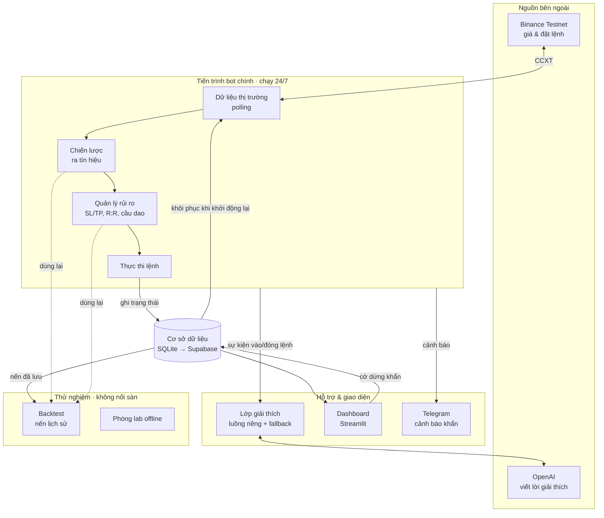

# KIẾN TRÚC — Bot Giao Dịch Tiền Mã Hóa

> Sơ đồ kiến trúc tổng thể + cấu trúc thư mục + giải thích từng thành phần.
> Dựa trên các quyết định ở `system_requirements.md`.
> Cập nhật lần cuối: 2026-10-18

---

## 1. Sơ đồ kiến trúc tổng thể

> GitHub tự hiển thị sơ đồ Mermaid bên dưới thành hình.



**Nguyên tắc đọc sơ đồ:**
- **Luồng giao dịch** (DATA → STRAT → RISK → EXEC) là lõi, chạy liên tục.
- **Lớp giải thích** chạy luồng riêng — gọi OpenAI lỗi cũng không làm kẹt giao dịch.
- **Cơ sở dữ liệu** là điểm chung để lưu/khôi phục trạng thái và chia sẻ với dashboard.
- **Backtest & phòng lab** dùng lại đúng khối Chiến lược + Rủi ro, nhưng chạy trên nến lịch sử.

---

## 2. Cấu trúc thư mục dự án

```
crypto-trading-bot/
├─ README.md                      # giới thiệu ngắn + cách chạy
├─ project_handle.md              # điểm vào ngữ cảnh (đọc đầu tiên)
├─ system_requirements.md         # quyết định đã chốt (nguồn chính thức)
├─ brainstorm.md                  # ý tưởng chưa chốt
├─ ARCHITECTURE.md                # (tệp này) kiến trúc + cấu trúc thư mục
├─ requirements.txt               # thư viện Python
├─ .gitignore
├─ .env.example                   # mẫu biến môi trường (KHÔNG chứa khóa thật)
│
├─ config/
│  └─ config.yaml                 # tham số: cặp coin, khung giờ, ngưỡng rủi ro...
│
├─ bot/                           # mã nguồn chính của bot
│  ├─ main.py                     # điểm khởi động, vòng lặp chính
│  ├─ config_loader.py            # đọc config + biến môi trường
│  │
│  ├─ exchange/                   # ◆ LỚP SÀN (tách riêng — đổi testnet/thật)
│  │  ├─ base.py                  # giao diện chung cho mọi sàn
│  │  └─ binance_exchange.py      # cài đặt cụ thể bằng CCXT
│  │
│  ├─ data/                       # dữ liệu thị trường
│  │  ├─ market_data.py           # polling giá/nến từ sàn
│  │  └─ candle_store.py          # lưu/đọc nến lịch sử trong DB
│  │
│  ├─ strategy/                   # ◆ BỘ MÁY CHIẾN LƯỢC
│  │  ├─ base.py                  # giao diện chung cho mọi chiến lược
│  │  ├─ indicators.py            # EMA, RSI, MACD...
│  │  ├─ ema_crossover.py         # chiến lược đầu tiên
│  │  └─ grid.py                  # chiến lược thứ hai
│  │
│  ├─ risk/                       # ◆ QUẢN LÝ RỦI RO
│  │  ├─ risk_manager.py          # position sizing, SL/TP, kiểm tra R:R
│  │  └─ circuit_breakers.py      # 3 cầu dao ngắt
│  │
│  ├─ execution/                  # thực thi & theo dõi
│  │  ├─ order_manager.py         # đặt/hủy/theo dõi lệnh
│  │  └─ portfolio.py             # số dư, vị thế, tính lãi/lỗ (PnL)
│  │
│  ├─ storage/                    # ◆ LỚP LƯU TRỮ (tách riêng — đổi SQLite/Supabase)
│  │  ├─ base.py                  # giao diện chung
│  │  ├─ sqlite_store.py          # dùng khi học
│  │  └─ supabase_store.py        # dùng khi lên thật
│  │
│  ├─ explain/                    # ◆ LỚP GIẢI THÍCH (luồng riêng)
│  │  ├─ explainer.py             # hàng đợi sự kiện + điều phối
│  │  ├─ llm_openai.py            # gọi OpenAI
│  │  └─ templates.py             # mẫu dự phòng khi LLM lỗi
│  │
│  ├─ safety/                     # độ bền vận hành
│  │  ├─ heartbeat.py             # điểm danh sức khỏe
│  │  └─ kill_switch.py           # đọc/ghi cờ dừng khẩn
│  │
│  ├─ notify/
│  │  └─ telegram.py              # gửi cảnh báo khẩn
│  │
│  └─ utils/
│     └─ logging_setup.py         # log có tự xoay vòng (rotation)
│
├─ backtest/
│  ├─ backtester.py               # chạy chiến lược trên nến lịch sử
│  └─ offline_lab.py              # phòng lab mô phỏng offline
│
├─ dashboard/
│  └─ app.py                      # Streamlit (tiến trình riêng, có mật khẩu)
│
├─ scripts/
│  └─ fetch_history.py            # tải nến lịch sử về DB
│
├─ deploy/
│  ├─ crypto-trading-bot.service  # tệp dịch vụ systemd (mẫu)
│  └─ README.md                   # hướng dẫn deploy lên Oracle
│
├─ .github/workflows/
│  └─ deploy.yml                  # tự động deploy khi push vào main
│
└─ tests/                         # kiểm thử (ít nhất cho chiến lược & rủi ro)
```

> Dấu ◆ đánh dấu 4 lớp được **tách riêng có chủ đích**, để đổi thành phần chỉ bằng
> sửa config, không đụng logic (xem "Nguyên tắc kiến trúc" trong `system_requirements.md`).

---

## 3. Giải thích từng thành phần

| Thành phần | Nhiệm vụ | Vì sao thiết kế vậy |
|---|---|---|
| `bot/main.py` | Vòng lặp chính: mỗi chu kỳ đọc dữ liệu → tín hiệu → rủi ro → lệnh → ghi trạng thái → phát sự kiện giải thích → heartbeat | Một nơi điều phối duy nhất, dễ hiểu dễ sửa |
| `exchange/` | Giao tiếp sàn qua CCXT | Tách riêng để đổi testnet ↔ thật bằng config |
| `data/` | Lấy giá/nến (polling) + lưu nến lịch sử | Polling nhẹ, hợp khung 1h/4h; lưu nến để backtest nhanh |
| `strategy/` | Tính chỉ báo + ra tín hiệu MUA/BÁN/ĐỨNG NGOÀI | Luật rõ ràng, backtest được — LLM KHÔNG tham gia bước này |
| `risk/` | Tính khối lượng lệnh, đặt SL/TP, kiểm R:R, 3 cầu dao ngắt | Lớp "phanh" bảo vệ tài khoản, tách khỏi chiến lược |
| `execution/` | Đặt/theo dõi lệnh, cập nhật vị thế & PnL | Tách khâu "quyết định" khỏi khâu "thực thi" |
| `storage/` | Lưu/đọc trạng thái, lịch sử, nến, cờ dừng | Tách riêng để đổi SQLite ↔ Supabase |
| `explain/` | Dịch quyết định sang lời dễ hiểu (OpenAI + fallback) | Luồng riêng, lỗi không ảnh hưởng giao dịch |
| `safety/` | Heartbeat + công tắc dừng khẩn | Phát hiện bot chết; cho phép dừng ngay |
| `notify/` | Gửi cảnh báo Telegram | Báo động khi không nhìn dashboard |
| `backtest/` | Chạy chiến lược trên dữ liệu lịch sử + phòng lab offline | Học nhanh, thử chiến lược trước khi chạy demo |
| `dashboard/` | Xem báo cáo, đọc giải thích, nút dừng khẩn | Tiến trình riêng, đọc từ DB |

---

## 4. Luồng một chu kỳ giao dịch (tóm tắt)

1. Kiểm tra **cờ dừng khẩn** và **3 cầu dao ngắt** → nếu kích hoạt thì dừng.
2. Lấy dữ liệu nến mới (polling).
3. Chiến lược tính chỉ báo → ra tín hiệu.
4. Nếu có tín hiệu: rủi ro tính khối lượng, đặt SL/TP, kiểm R:R ≥ 1.5.
5. Đủ điều kiện → thực thi lệnh; cập nhật vị thế.
6. **Ghi trạng thái vào DB** (để khôi phục nếu bot khởi động lại).
7. Phát sự kiện sang **lớp giải thích** (luồng riêng) để viết lời giải thích.
8. Gửi **heartbeat**; ghi log.
